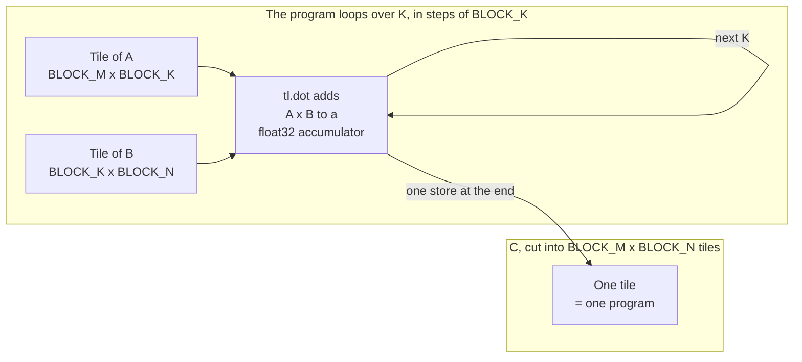

# TileKernels

A study of how GPU kernels are written and compiled, using [Triton](https://github.com/triton-lang/triton).
It has a fused softmax and a tiled matrix multiplication, both checked against PyTorch, plus tools for
benchmarking them and for reading what the compiler generates.

## Status

| What | State |
|---|---|
| Correctness against PyTorch, in Triton's interpreter on CPU | Tested |
| Compiling every kernel for `sm_75` to `sm_100`, down to the cubin | Tested, with no GPU |
| Compiler dumps and the walkthrough | Done, for `sm_86` |
| Running compiled on a real GPU | **Not done yet.** This was built without a GPU |
| Benchmark results | **Pending.** See [Results](#results) |

## Install

Python 3.10 or newer. On a machine with no GPU, install the CPU build of PyTorch first.

```bash
pip install torch --index-url https://download.pytorch.org/whl/cpu
```

```bash
pip install -e ".[dev]"
```

Upstream Triton publishes Linux wheels only. On Windows, `pyproject.toml` installs `triton-windows`, the
Windows port under the same GitHub organisation, which imports as `triton`. On Python 3.10 you get
Triton 3.8, because Triton 3.9 dropped that version.

## Quickstart

With no GPU, this runs in Triton's interpreter on CPU. The variable has to be set before the import.

```python
import os

os.environ["TRITON_INTERPRET"] = "1"

import torch

from tilekernels import fused_softmax, online_softmax, tiled_matmul

x = torch.randn(4, 100)
torch.testing.assert_close(fused_softmax(x), torch.softmax(x, dim=-1), rtol=1e-5, atol=1e-6)
torch.testing.assert_close(
    online_softmax(x, block_size=16), torch.softmax(x, dim=-1), rtol=1e-5, atol=1e-6
)

a, b = torch.randn(13, 7), torch.randn(7, 9)
c = tiled_matmul(a, b, block_m=8, block_n=8, block_k=8)
torch.testing.assert_close(c, a @ b, rtol=1e-4, atol=1e-4)
```

On a GPU, leave out the variable and put the tensors on `"cuda"`.

## The kernels

The structure follows the patterns in Triton's official tutorials. The stride support, the online
softmax's special value handling, the validation and the tests are specific to this project. The math and
the memory access patterns are in [docs/KERNEL_NOTES.md](docs/KERNEL_NOTES.md).

### Fused softmax

Normalizing a row with separate GPU operations means reading and writing memory for each step: max,
subtract, exp, sum, divide. `fused_softmax` does them all in one program per row, with one read and one
write. Everything else stays in registers.

Subtracting the row's max first keeps `exp` from overflowing. Rows narrower than the block are handled by
a mask, and missing columns load as `-inf`, which become `exp(-inf) = 0` and so cannot affect the result.

`online_softmax` handles rows wider than a block, by keeping a running max and running sum. It needs a
second read of the input, because the output depends on the final max and sum.

### Tiled matmul

`tiled_matmul` cuts the output into tiles, and each program computes one tile:



Shapes do not have to be multiples of the block sizes. Masked elements load as 0, and a row or column of
zeros adds nothing to a product, so partial tiles need no special handling. `GROUP_M` changes only the
order of programs, so that consecutive programs reuse the same tiles of B in the L2 cache.

### Input rules

Every wrapper checks its inputs and raises a clear error. Inputs must be 2D, non-empty, float32 or float16,
and have no autograd graph. Any strides are accepted, including transposes and slices. An output you pass
in may be strided too, but must not overlap an input.

## Tests

```bash
pytest
```

This took about two minutes on the laptop this was built on, with no GPU. It covers:

- **Correctness.** Each kernel against `torch.softmax` and `torch.matmul`, on seeded random inputs,
  including shapes that are not multiples of the blocks, in Triton's interpreter.
- **Edge cases.** Very large values, `-inf`, `NaN`, identical values, and non-contiguous tensors.
- **Mutations.** Copies of the kernels with a mask deliberately broken must fail the same checks. See
  [tests/test_mask_mutations.py](tests/test_mask_mutations.py).
- **Compilation.** The interpreter never runs the compiler, so a separate process compiles each kernel for
  real GPU targets. See [tests_compile/](tests_compile/test_compile_for_gpu.py).
- **Documentation.** Each dump excerpt in the docs must still be in the committed dumps.

To skip the slowest tests:

```bash
pytest -m "not slow"
```

On a GPU, the same tests run compiled. This has not been run yet.

```bash
pytest --gpu
```

## Benchmarks

These need a GPU, and refuse to run in interpreter mode or without one. Timings from the interpreter say
nothing about a GPU. [docs/RUNNING_ON_A_GPU.md](docs/RUNNING_ON_A_GPU.md) has steps for free Colab and
Kaggle GPUs.

```bash
python -m benchmarks.bench_softmax
```

```bash
python -m benchmarks.bench_matmul
```

Each one checks a configuration against PyTorch before timing it, then writes a CSV, plots and a summary to
`results/`. Add `--quick` for a small sweep.

## Results

**Pending: run on a GPU to fill this in.** There are no benchmark numbers yet, because the machine this was
built on has no CUDA GPU. See [results/README.md](results/README.md).

Static facts about the generated code do not need a GPU, and are in
[dumps/experiments/results.md](dumps/experiments/results.md). They count instructions and registers,
and say nothing about speed.

## Reading the compiler output

```bash
python scripts/dump_ir.py --all
```

This writes each stage of each kernel to `dumps/`, with no GPU needed, by compiling for an explicit target.
[docs/COMPILER_DUMPS.md](docs/COMPILER_DUMPS.md) walks through the softmax from TTIR to PTX, shows where
masks, reductions and `tl.dot` end up, and has debugging stories from real runs.

## Layout

```text
src/tilekernels/   softmax.py, matmul.py, utils.py
tests/             interpreter tests, run by plain pytest
tests_compile/     compile tests, which need their own process
benchmarks/        GPU sweeps
scripts/           dump_ir.py, ir_experiments.py, ir_tools.py
dumps/             committed compiler output (text stages only)
results/           benchmark output, once it exists
docs/              KERNEL_NOTES.md, COMPILER_DUMPS.md, RUNNING_ON_A_GPU.md
```

## Limitations and future work

- **Not yet run on a GPU.** Correctness has been shown in the interpreter, which ignores `tf32` and uses a
  different `exp`. Compilation has been shown on GPU targets. Together these do not prove that the compiled
  code is right, and `pytest --gpu` is the missing check.
- **No autotuning.** There is a sweep that writes a CSV, but no integration with `triton.autotune`.
- **No backward pass.** Inputs that require grad are rejected, instead of silently losing the graph.
- **No bf16 or fp8.** Only float32 and float16.
- **2D inputs only**, and softmax is along the last dimension only.
- **Single GPU.**
- **Memory offsets are 32-bit.** Tensors spanning more than 2^31 elements are rejected.
- **cuBLAS is not the target here.** Expect it to win on matmul at full precision: this kernel has no tuned
  software pipelining, no layout chosen for tensor cores, and no autotuned configurations.

## License

[MIT](LICENSE)
